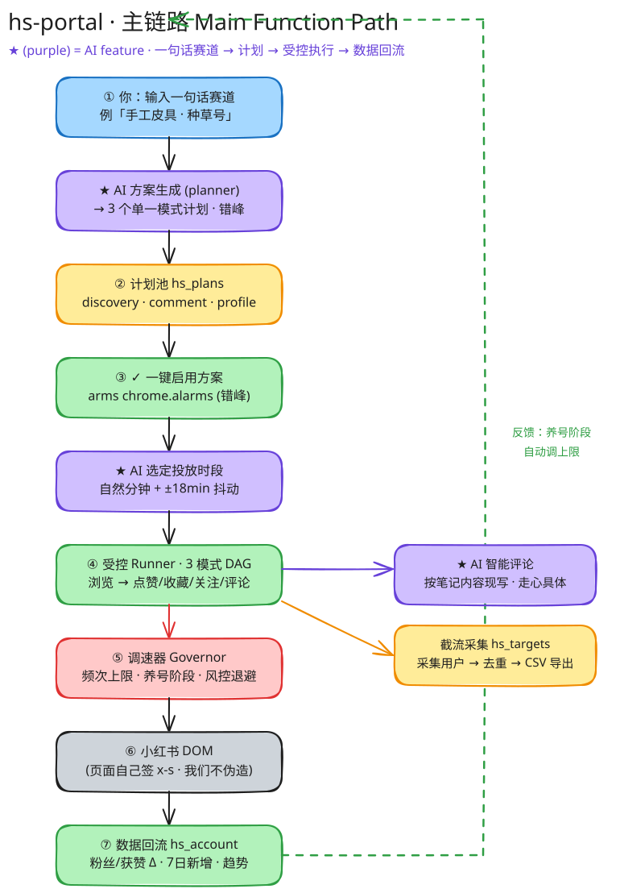
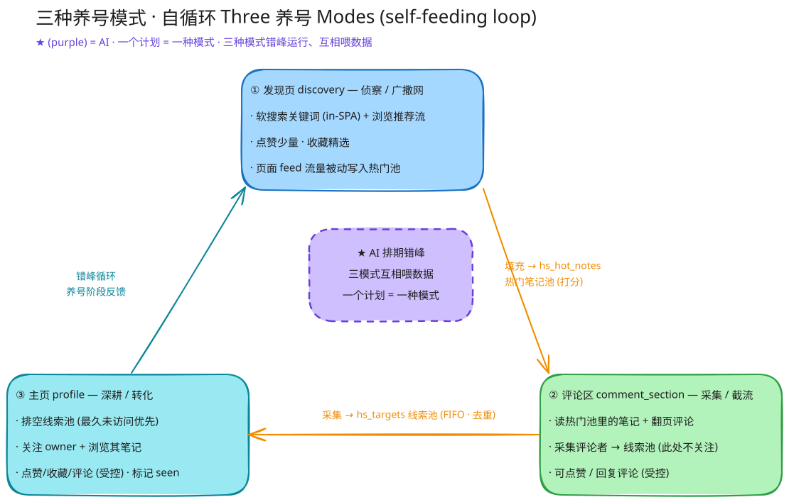
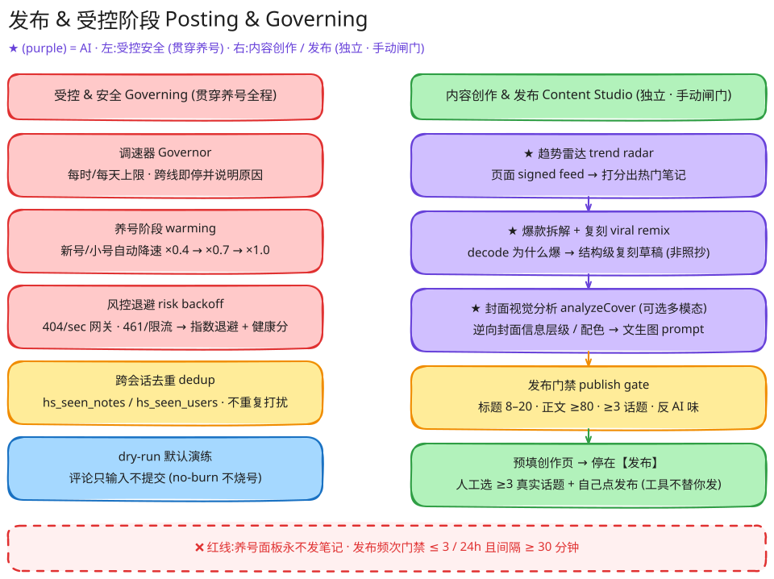
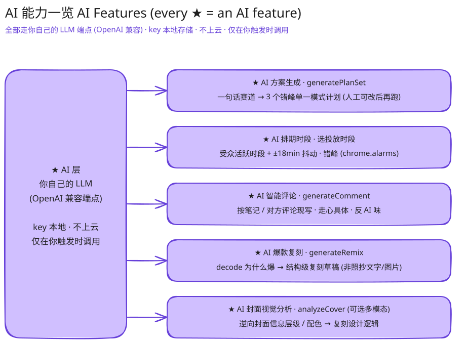

# hs-portal

A local, **GUI-first** Chrome extension (MV3, zero-build) for keeping mainland Xiaohongshu
(小红书) accounts healthy and growing — browse · like · collect · follow · comment · 截流采集 —
without tripping 风控. Forked in spirit from **Redaily** (cloud stripped out), with a visible
**governor**, humanized timing, a self-feeding targeting loop, and our own **AI layer**.

> **One line:** be a real browser, govern behavior with visible caps, let the AI plan & write,
> and keep publishing as a separate, deliberate, manual-gated path.

- **No cloud / no phone-home** — the only traffic is to Xiaohongshu itself and *your own* LLM endpoint.
- **Zero-build** — vanilla JS, MV3, Load unpacked from `extension/`. No npm, no bundler.
- **✨ / purple ★ = an AI feature** throughout this doc and the diagrams.

> Status (2026-06-12): all flows are built and `node --check`-clean with verified cross-file
> contracts; **live-testing on a real account is still pending** (only the discovery dry-run has
> been seen working live). See [CLAUDE.md](./CLAUDE.md) for the honest gap list.

---

## At a glance

| Phase | What you can do | Backing stores |
|---|---|---|
| **规划 Plan** | ✨ Type one sentence → AI emits 3 staggered single-mode plans · edit any plan · reuse a plan pool | `hs_plans` |
| **养号 Prepare** *(engagement)* | Run the 3 modes — **discovery · comment_section · profile** — that feed each other automatically | `hs_hot_notes`, `hs_targets`, `hs_seen_*` |
| **受控 Govern** | Per-hour/per-day caps · warming auto-throttle · risk backoff · cross-session dedup · dry-run | `hs_gov`, `hs_config`, `hs_account` |
| **创作 & 发布 Post** | ✨ Trend radar · ✨ viral-note remix → draft · publish gate · prefill the creator page (you click 发布) | `hs_hot_notes`, `hs_drafts`, `hs_publish_log` |
| **数据 Traction** | Followers / 获赞收藏 Δ per run · 7-day incoming likes & new followers · fans sparkline · harvested-lead CSV | `hs_account`, `hs_targets` |

---

## The main function path

From a one-sentence niche to a self-running, governed, self-measuring account — the spine of the
whole product. Everything purple is an AI step.



1. **You type a niche** (e.g. 「手工皮具 · 种草号」) — no config files, one screen.
2. **✨ AI plan generation** (`generatePlanSet`) returns **3 single-mode plans** (discovery +
   comment_section + profile) that share the niche and are time-staggered (错峰).
3. They land in the **plan pool** (`hs_plans`) — recallable, editable, the same shape a human would author.
4. **✓ Accept** arms all three on `chrome.alarms` — the only click scheduling needs.
5. **✨ AI picks the run times** (audience-active windows, organic minutes, ±18 min jitter) so the
   account never acts on a fixed daily minute.
6. The **governed Runner** executes one mode's DAG: browse a note → (governed) like / collect /
   follow / comment → close → next.
7. The **Governor** clamps everything — frequency caps, warming phase, risk backoff.
8. Actions land on the real **Xiaohongshu DOM**; the page signs its own `x-s` (we never forge it).
9. At the end of every run, **account traction flows back** (followers / 获赞收藏 Δ, 7-day stats)
   and the warming phase feeds back into the caps.

Two side-branches off the Runner: **✨ AI smart comments** (written per note) and **lead harvesting**
into `hs_targets` (截流采集 → de-dupe → CSV export).

---

## Account-preparation phase (养号) — the three modes

养号 = "account nurturing": behave like a real, weighted user so the algorithm trusts the account.
**One plan = one mode** (fusing modes hurts 垂直度 and reads like a bot). The three modes form a
**self-feeding loop** — one fills a pool, the next drains it — so a campaign runs with zero pasting.



| Mode | Role | What it does | Feeds |
|---|---|---|---|
| **① discovery** 发现页 | scout · 广撒网 | Soft in-SPA keyword search + browse the recommend feed, type-aware reading, like a little / collect the best. The page's own signed feed traffic is captured passively. | → `hs_hot_notes` (scored hot-note pool) |
| **② comment_section** 评论区 | harvester · 截流 | Reads notes from the hot-note pool, paginates their comments, and harvests commenters into the lead pool. **Does not follow here** — it leaves leads un-visited so the closer can drain them. | → `hs_targets` (lead pool, FIFO + de-duped) |
| **③ profile** 主页 | closer · 转化 | Drains the lead pool oldest-first: visits un-visited leads, follows the owner, browses their notes, likes/collects/comments, and marks them seen so nobody is bothered twice. | drains `hs_targets`; loops back |

The loop repeats on the AI-staggered schedule: discovery surfaces fresh notes → comment_section
harvests their commenters → profile gradually engages those accumulated leads. Manual plans still
work too — paste note URLs (comment_section) or profile URLs (profile) instead of self-sourcing.

**Engagement is plan-honoring:** each action's `count` is a per-session budget, and in discovery the
engagement probability spreads that budget across the planned notes (stochastic, not every-note-every-action).

---

## Posting & governing phase

Two systems run on top of 养号: a **governor** that keeps engagement safe, and a separate,
deliberately higher-ceremony **Content Studio** for creating and publishing notes.



### Governing (受控 · safety — runs through the whole 养号 flow)
- **Governor** — per-hour / per-day caps; crossing a cap stops *that* action with a visible reason.
- **Warming curve** — a fresh or small account is auto-throttled (×0.4 → ×0.7 → ×1.0), scaled by the
  *min* of a fans-based and an age-based factor, with zero operator input.
- **Risk backoff** — a 404/sec gate (`error_code=300031`) or a 461/限流 signal (read from the page's
  own traffic via the MAIN-world interceptor) pauses all actions with exponential backoff + a health drop.
- **Cross-session dedup** — `hs_seen_notes` / `hs_seen_users` skip already-opened posts and
  already-visited/followed profiles, across runs.
- **dry-run by default** — browses for real but only *logs* the capped mutations; comments are
  **type-only unless `submit:true`** (no-burn 不烧号).

### Posting (创作 & 发布 · Content Studio — separate, manual-gated)
- ✨ **Trend radar** — scores hot notes from the page's own signed feed traffic into `hs_hot_notes`.
- ✨ **Viral-note remix** (`generateRemix`) — decodes *why* a source note worked, then does a
  structural re-creation (结构级复刻, never a copy) into a publishable draft (`hs_drafts`).
- ✨ **Cover vision analysis** (`analyzeCover`, optional, multimodal) — reverse-engineers the cover's
  information hierarchy / palette into a 文生图 prompt.
- **Publish gate** — title 8–20 chars · body ≥ 80 · ≥ 3 topics · an anti-AI "concrete signal" check.
- **Prefill, then stop** — the extension fills cover + title + body on the creator page and **stops at
  the 发布 button**. You pick ≥ 3 real topics and click publish yourself.

> **❌ Red line:** the 养号 panel **never** posts notes. Publishing lives only in the manual-gated
> portal, and is frequency-capped (≤ 3 / 24h, ≥ 30 min apart).

---

## AI features (every ✨)

Every AI call goes through *your own* OpenAI-compatible LLM endpoint — the key is stored locally,
never shipped or phoned home, and only called when you trigger it. The AI **only proposes**; the
governor clamps and (for publishing) you confirm.



| ✨ Feature | Function | What it gives you |
|---|---|---|
| **AI plan set** | `generatePlanSet` | One sentence → 3 conservative, staggered single-mode plans (edit before running) |
| **AI scheduling** | planner + `chrome.alarms` | Run times chosen from the niche's active windows + jitter — you never set a time |
| **AI smart comments** | `generateComment` | One short, on-topic, human-sounding Chinese comment per note / reply, anti-generic-filler |
| **AI viral remix** | `generateRemix` | Decode a hot note's success → structural re-creation as a draft (titles · body · cover · images · topics) |
| **AI cover vision** | `analyzeCover` | Optional multimodal reverse-engineering of a cover's design logic |

---

## Load & run

1. `chrome://extensions` → enable **Developer mode** → **Load unpacked** → select `extension/`.
2. Open a tab on `https://www.xiaohongshu.com/` and **reload it once** so the content script injects.
3. Open the toolbar popup, or use the in-page 养号 panel (the real dashboard).
4. ✨ Generate a campaign → **✓ Accept** (or pick a pool plan) → **▶ Run** (dry-run is the default).

> **MV3 gotcha:** after any change to `background.js`, **reload the extension** (`chrome://extensions` → ↻)
> or the popup hits a stale service worker (symptom: `Unknown message type: …`). Editing a content
> script or the manifest also needs the reload **plus** an XHS tab reload.
> Session logs auto-save to `~/Downloads/hs-portal/session-log.json`.

---

## Project layout

```
extension/                     the loadable extension (zero-build, Load unpacked)
  manifest.json                MV3, XHS-scoped hosts, our own identity (no cloud key/update_url)
  rules/shield.json            DNR: block + header-spoof the shield/webprofile telemetry endpoint
  src/
    lib/human.js               humanized primitives (jittered delay, click, scroll, typeText)
    lib/plan.js                Plan schema — the brain↔spine contract (modes, filters, actionMix, pacing)
    lib/governor.js            frequency governor + risk backoff (pure, unit-tested)
    lib/planner.js             ✨ AI layer — generatePlanSet / generateComment / generateRemix / analyzeCover
    lib/secrets.local.js       bundled dev LLM key (do not ship/commit)
    content/engine.js          atomic XHS ops + selectors (SEL map) + own-account reads + nethook bridge
    content/nethook.js         MAIN-world net interceptor (reads the page's OWN signed responses)
    content/panel.js           in-page Shadow-DOM 养号 dashboard (plan-picker, traction tile, editor, log)
    content/publisher.js       creator-page prefill ops (publish path)
    background.js              orchestrator: runner loop, governor, plan/account/targets stores, AI handler
  popup/                       toolbar launcher (status glance + Content Studio button)
  portal/                      Content Studio — separate full-page UI for trends/drafts/publish/stats
docs/diagrams/                 the Excalidraw sources + rendered SVGs used in this README
```

**Read next:** [PLAN.md](./PLAN.md) · [ARCHITECTURE.md](./ARCHITECTURE.md) ·
[RISK-MODEL.md](./RISK-MODEL.md) · [CLAUDE.md](./CLAUDE.md) (status & conventions) ·
[redaily-extension-teardown.md](./redaily-extension-teardown.md).

---

## Non-negotiables

- Be a **real** browser — never fake fingerprints; the real environment is the asset.
- **One account ⇄ one environment ⇄ one consistent CN IP.**
- **Local-only** data; no third-party phone-home (only XHS + your own LLM).
- **Engagement ≠ publishing** — never let the publish path ride the 养号 engine.
- **GUI-first & transparent** — visible caps, visible risk; minimal opaque auto-behavior.
- **No-burn testing** — dry-run + a canary account before any main account.

> **Legal reality check:** automated engagement and user-harvesting conflict with the platform's
> rules — this tool *reduces detection*, it does not make the activity compliant. Account loss is a
> real, accepted risk. See [PLAN.md §15](./PLAN.md).

---

### About the diagrams

All four diagrams were drawn with **Excalimate** and live as editable
`docs/diagrams/*.excalidraw` files (open them in Excalimate / [excalidraw.com](https://excalidraw.com)).
Re-render the SVGs with `node docs/diagrams/_render.mjs <file>.excalidraw`.
